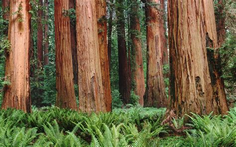
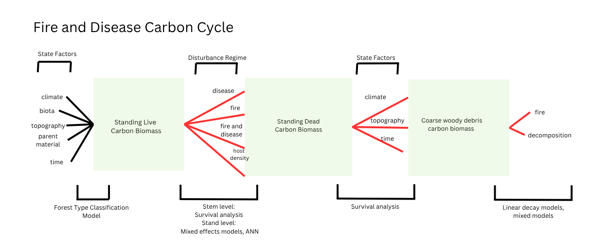
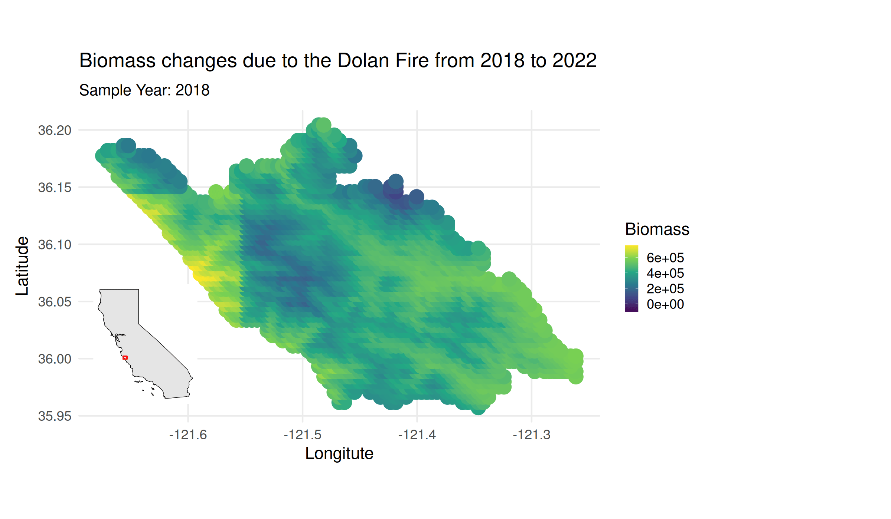

# Carbon Dynamics due to Sudden Oak Death and Fire Interactions in Big Sur   



## Main research questions      

i) How has carbon biomass changed due to fire and disease throughout the inventory? How has species (Tanoak, Coast Live Oak, Redwood, Bay Laurel) density and biomass been altered?    

ii) In diseased stands, when wildfire occurs do we see higher mortality in redwood than in non-diseased stands?    

iii) How does tanoak size interact with pathogen presence to determine mortality rates? Do we see that larger trees die when the pathogen is present?    

      a) How does bay laurel density influence tanoak mortality rates?   

iv) How do state factors influence forest type and snag fall rates?    

v) How does fire and disease influence coarse woody debris mass? How much CWD is burnt in fires? How does pathogen presence impact CWD pools?     

vi) Which factors, size, species, or burn status, influence CWD decomposition rates?   


## Fire/disease graphical model    
Through my research, I aim to quantify the fluxes between three main carbon pools -- living biomass, snags and CWD. Below I outline the proposed carbon cycle between these main pools.   




#### Libraries Needed     

```{r}
library(leaflet)
library(gt)
library(arrow)
library(stringr)
library(broom)
library(gtsummary)
library(survival)
library(ggsurvfit)
library(lme4) 
library(lmerTest)
library(knitr)
library(kableExtra)
library(ggalluvial)
library(tidyverse)
library(bigsurrr)
library(patchwork)
library(furrr)
library(sf)
library(performance)
library(lavaan)
library(bestNormalize)
library(ggridges)
library(ggcube)
library(geometry)
library(fixest)
library(plm)
library(dynamite)
library(broom)
library(broom.mixed)
library(ggdag)
library(BayesFactor)
library(brms)

```

## Main Analysis      

### Normalizing the stem data      
Assuming continuous variables must be normalized for path analysis, mixed effects, fixed effects and survival analysis.     

- Utilizing [orderNorm()](https://www.rdocumentation.org/packages/bestNormalize/versions/1.9.2/topics/orderNorm)     


```{r}
#| fig-width: 16
#| fig-height: 9 

box_cox <- function(dfCol){
  log1p(dfCol)
}


normal <- function(df, stat, metric_need = TRUE, metric = NULL, status = NULL) {
  
  if (metric_need) {
    df1 <- df |> filter(ForestType == metric & Status == status)
  } else {
    df1 <- df
  }

  stat_vec <- df1 |> pull({{ stat }})
  stat_vec <- na.omit(stat_vec)
  
  a <- df1 |>
    ggplot(aes(x = {{ stat }})) +
    geom_histogram(aes(y = after_stat(density)), fill = "gray80", color = "black") +
    geom_density(color = "darkred", linewidth = 1, adjust = 1) +
    theme_bw() +
    labs(title = "Is the data normal?")

  n_obs <- length(stat_vec)
  
  if (n_obs >= 3 && n_obs <= 5000) {
    b <- shapiro.test(stat_vec)
    p_val_b <- b$p.value
    lbl <- if (p_val_b <= 0.1) "** Not normal" else "* Normally Distributed"
    
    a1 <- a + annotate(
      "text", 
      x = min(stat_vec, na.rm = TRUE), 
      y = Inf, 
      label = paste0(lbl, " (p = ", round(p_val_b, 3), ")"),
      vjust = 2, 
      hjust = 0, 
      size = 4,
      fontface = "bold"
    )
  } else if (n_obs > 5000) {
        
    a1 <- a   
  } else {
    a1 <- a + labs(subtitle = "N < 3: Insufficient data for Shapiro-Wilk test")
  }
 
  a2 <- df1 |>
    ggplot(aes(sample = {{ stat }})) +
    stat_qq() +
    stat_qq_line(color = "darkred", linewidth = 1) +
    theme_bw() +
    labs(title = "Q-Q Plot", x = "Theoretical Quantiles", y = "Sample Quantiles")

  a_final <- a1 / a2
  return(a_final)
}


t <- load_tree() |> filter(Species %in% c("SESE", "LIDE", "QUAG", "UMCA"))


p <- load_plot() |> select(Plot, SampleYear, Elevation, Slope, BurnScar, PRam, Fire, tFire, ForestType)

q <- left_join(t, p, by = c("Plot", "SampleYear")) |> distinct() 

q_sums <- q |>
  mutate(TotalBA = ((3.1415 * DBH ** 2) / 4000 * 20)) |>
  group_by(Plot, Species, SampleYear, Status, PRam, Fire, ForestType) |>
  mutate(Status = case_when(
                            Status == "L" ~ 0,
                            TRUE ~ 1)) |>
  summarize(TotalStem = (n() * 20),
            TotalBiomass = ((sum(Biomass, na.rm = TRUE) * 20) * 0.001),
            TotalBA = sum(TotalBA, na.rm = TRUE)) |>
  distinct() 


q_sums$TotalBiomassNorm <- box_cox(q_sums$TotalBiomass)
q_sums$TotalStemNorm <- box_cox(q_sums$TotalStem)


```

```{r}

dag <- dagify(Redwood_Biomass ~ Fuels,
Fuels ~ Disease + Fire,
labels = c(
           "Redwood_Biomass" = "Redwood Biomass",
           "Fuels" = "Fuels",
           "Fire" = "Fire",
           "Disease" = "Disease"),
  latent = "Disease",
  exposure = "Fire",
  outcome = "Redwood_Biomass"
)

ggdag_paths(dag, text = FALSE, use_labels = "label", shadow = TRUE)

```

### Extract and transform other datasets    

**Lide snag host biomass**            
- Only 160 plots with snag LIDE data    

```{r}
snag_host <- q_sums |>
  filter(Species == "LIDE" & Status == 1) |>
  group_by(Plot, SampleYear) |>
  mutate(LideSnagStemDensity = TotalStem,
         LideSnagBiomass = TotalBiomass) |>
  select(Plot, SampleYear, Status, LideSnagStemDensity, LideSnagBiomass)


snag_host$LideSnagBiomassNorm <- box_cox(snag_host$LideSnagBiomass)
snag_host$LideSnagStemDensityNorm <- box_cox(snag_host$LideSnagBiomass)

snag_host <- snag_host |> select(Plot, SampleYear, LideSnagStemDensity, LideSnagBiomass, LideSnagBiomassNorm, LideSnagStemDensityNorm)


```

**Cwd host biomass**        
- 94 plots with cwd host data    
- See dataset cleaning page for how this data was obtained (summarizing total mass of individual stems of LIDE, QUAG)      

```{r}
m <- load_meta() |> select(Plot, SampleYear, CWD_Host_Biomass) |>
  select(Plot, SampleYear, CWD_Host_Biomass) |>
  rename(CwdHostBiomass = CWD_Host_Biomass) |>
  distinct()

m$CwdHostBiomassNorm <- box_cox(m$CwdHostBiomass) 


```

**UMCA stem densities**         
- 183 plots with UMCA stand density data    


```{r}
umca <- q_sums |>
 filter(Species == "UMCA" & Status == 0) |>
 rename(UmcaStemDensity = TotalStem)

umca$UmcaStemDensityNorm <- box_cox(umca$UmcaStemDensity) 

umca <- umca |>
  ungroup() |>
  select(Plot, SampleYear, UmcaStemDensity, UmcaStemDensityNorm)


```

**LIDE living stem densities**         
- 169 plots with LIDE living stand density data    

```{r}
lide_d <- q_sums |>
 filter(Species == "LIDE" & Status == 0) |>
 rename(LideStemDensity = TotalStem)

lide_d$LideStemDensityNorm <- box_cox(lide_d$LideStemDensity) 

lide_de <- lide_d |>
  ungroup() |>
  select(Plot, SampleYear, LideStemDensity, LideStemDensityNorm)

```


#### Final dataset      
There are two final datasets -- 
1) Includes all standing biomass:
  - n = 274 (with na's for years with standing biomass data but no snag host, UMCA or LiDE living stem density)  
  - t = 2006 - 2023     

```{r}

all_year <- left_join(q_sums, snag_host, by = c("Plot", "SampleYear"), relationship = "many-to-many")

all_year <- left_join(all_year, umca, by = c("Plot", "SampleYear"), relationship = "many-to-many")

all_year$TotalBiomassNorm = box_cox(all_year$TotalBiomass)

all_year <- left_join(all_year, p, by = c("Plot", "SampleYear", "PRam", "Fire", "ForestType"))

all_year <- left_join(all_year, lide_de, by = c("Plot", "SampleYear"))

all_year$ElevationNorm <- box_cox(all_year$Elevation)
all_year$SlopeNorm <- box_cox(all_year$Slope)
all_year$tFireNorm <- box_cox(all_year$tFire)


```


2) Includes coarse woody debris:      

**47 unique plots with redwood living biomass data, tanoak snag data and cwd data.**      

```{r}
cwd_year <- left_join(m, all_year, by = c("Plot", "SampleYear")) 

cwd_year <- cwd_year |>
  mutate(DiseaseFuels = LideSnagBiomass + CwdHostBiomass,
         DiseaseFuelsNorm = LideSnagBiomassNorm + CwdHostBiomassNorm
) |>
  distinct() |>
  filter(ForestType == 2 & Species == "SESE" & Status == 0) |>
  mutate(Group = case_when(
                           PRam == 1 & Fire == 0 ~ "SOD",
                           PRam == 0 & Fire == 1 ~ "Fire",
                            PRam == 1 & Fire == 1 ~ "SOD + Fire",
                           TRUE ~ "Control"

)) |>
  group_by(Plot) |>
  arrange(SampleYear, .by_group = TRUE) |>
  mutate(
         TotalBiomass_lag = dplyr::lag(TotalBiomass),
         TotalStem_lag    = dplyr::lag(TotalStem),
         Year_lag         = dplyr::lag(SampleYear),
    # change since the previous sample
    TotalBiomass_chg = TotalBiomass - TotalBiomass_lag,
    TotalStem_chg    = TotalStem - TotalStem_lag,
    years_between    = SampleYear - Year_lag
  ) |>
  ungroup()


n <- cwd_year |>
  filter(is.na(cwd_year$Group))

```

```{r}
stem <- t |> 
  rename(status = Mortality) |>
  mutate(status = case_when(
                            status == 0 ~ 1,
                            TRUE ~ 2),
  t = SampleYear - 2005) |>
  select(Plot, StemId, Species, SampleYear, DBH, status, t)

all_a <- all_year |>
  ungroup() |>
  select(!c(Species, Status, TotalStem, TotalBiomass, TotalStemNorm, TotalBiomassNorm))

cwd_a <- cwd_year |>
  ungroup() |>
  select(!c(Species, Status, TotalStem, TotalBiomass, TotalStemNorm, TotalBiomassNorm, TotalBA))


stem_all <- left_join(stem, all_a, by = c("Plot", "SampleYear")) |> distinct()

stem_cwd <- right_join(stem, cwd_a, by = c("Plot", "SampleYear")) |> distinct() |>
  distinct() |>
  filter(ForestType == 2 & Species == "SESE") |>
  mutate(Group = case_when(
                           PRam == 1 & Fire == 0 ~ "SOD",
                           PRam == 0 & Fire == 1 ~ "Fire",
                            PRam == 1 & Fire == 1 ~ "SOD + Fire",
                           TRUE ~ "Control"

))


old_stem <- stem_cwd |> filter(DBH >= 20)


old_sums <- old_stem |> select(Plot) |> distinct() |>
  right_join(cwd_year, by = "Plot") |>
  mutate(TotalStem = TotalStem * 20,
         TotalBA = TotalBA * 20)


```

## Disease and Fuels    

```{r}

h <- cwd_year |> filter(PRam == 0 & ForestType == 2)
d <- cwd_year |> filter(PRam == 1 & ForestType == 2)


summary(h$CwdHostBiomass)  
summary(d$CwdHostBiomass)  


f_mod <- lmer(CwdHostBiomass ~ PRam + Fire + Elevation + Slope + (1 | SampleYear) + (1 | Plot), data = cwd_year)

summary(f_mod)

AIC(f_mod)


cwd <- cwd_year |>
  ggplot(aes(y = Group, x = CwdHostBiomass, fill = Group)) +
  geom_density_ridges() +
  labs(x = "Host CWD Biomass (Mg ha -1)", y = "") +
  theme_classic()  

sn <- cwd_year |>
  ggplot(aes(y = Group, x = LideSnagBiomass, fill = Group)) +
  geom_density_ridges() +
  labs(x = "Tanoak Snag Biomass (Mg ha -1)", y = "") +
  theme_classic()  

r <- cwd_year |>
  filter(Species == "SESE" & Status == 0) |>
  ggplot(aes(y = Group, x = TotalBiomass, fill = Group)) +
  geom_density_ridges() +
  labs(x = "Redwood Biomass (Mg ha -1)", y = "") +
  theme_classic()  

cwd2 <- cwd_year |>
  group_by(SampleYear, Group) |>
  summarize(MeanBio = mean(CwdHostBiomass, na.rm = TRUE),
            SdBio = sd(CwdHostBiomass, na.rm = TRUE)) |>
  ggplot(aes(x = SampleYear, y = MeanBio, color = Group)) +
  geom_point() +
  geom_line() +
  labs(y = "Host CWD Biomass (Mg ha -1)", x = "SampleYear") +
  theme_classic()  

sn2 <- cwd_year |>
  group_by(SampleYear, Group) |>
  summarize(MeanBio = mean(LideSnagBiomass, na.rm = TRUE),
            SdBio = sd(LideSnagBiomass, na.rm = TRUE)) |>

  ggplot(aes(x = SampleYear, y = MeanBio, color = Group)) +
  geom_point() +
  geom_line() +
  labs(y = "Tanoak Snag Biomass (Mg ha -1)", x = "SampleYear") +
  theme_classic()  

r2 <- cwd_year |>
  filter(Species == "SESE" & Status == 0) |>
  group_by(SampleYear, Group) |>
  summarize(MeanBio = mean(TotalBiomass, na.rm = TRUE),
            SdBio = sd(TotalBiomass, na.rm = TRUE)) |>


  ggplot(aes(x = SampleYear, y = MeanBio, color = Group)) +
  geom_point() +
  geom_line() +
  labs(y = "Redwood Biomass (Mg ha -1)", x = "SampleYear") +
  theme_classic() 


stem_d <- cwd_year |> 
  filter(Species == "SESE" & Status == 0) |>
  ggplot(aes(y = Group, x = TotalStem, fill = Group)) +
  geom_density_ridges() +
  labs(x = "Stem Density (trees ha-1)", y = "") +
  theme_classic() 

 

stem_d2 <- cwd_year |>
  filter(Species == "SESE" & Status == 0) |>
  group_by(SampleYear, Group) |>
  summarize(MeanStem = mean(TotalStem, na.rm = TRUE),
            SdStem = sd(TotalStem, na.rm = TRUE)) |>
  ggplot(aes(x = SampleYear, y = MeanStem, color = Group)) +
  geom_point() +
  geom_line() +
  labs(y = "Stem Density (trees ha-1)", x = "SampleYear") +
  theme_classic() 

ba <- cwd_year |> 
  filter(Species == "SESE" & Status == 0) |>
  ggplot(aes(y = Group, x = TotalBA, fill = Group)) +
  geom_density_ridges() +
  labs(x = "Basal Area (m2 ha-1)", y = "") +
  theme_classic() 

 

ba2 <- cwd_year |>
  filter(Species == "SESE" & Status == 0) |>
  group_by(SampleYear, Group) |>
  summarize(MeanBA = mean(TotalBA, na.rm = TRUE),
            SdBA = sd(TotalBA, na.rm = TRUE)) |>
  ggplot(aes(x = SampleYear, y = MeanBA, color = Group)) +
  geom_point() +
  geom_line() +
  labs(y = "Basal Area (m2 ha-1)", x = "SampleYear") +
  theme_classic() 


dbh_dead <- stem_cwd |> 
  filter(Species == "SESE" & status == 2) |>
  ggplot(aes(y = Group, x = DBH, fill = Group)) +
  geom_density_ridges() +
  labs(x = "Diameter of Dead Tree (cm)", y = "") +
  theme_classic() 

 

dbh_dead2 <- stem_cwd |>
  filter(Species == "SESE" & status == 2) |>
  group_by(SampleYear, Group) |>
  summarize(MeanDBH = mean(DBH, na.rm = TRUE),
            SdBio = sd(DBH, na.rm = TRUE)) |>
  ggplot(aes(x = SampleYear, y = MeanDBH, color = Group)) +
  geom_point() +
  geom_line() +
  labs(y = "Diameter of Dead Tree (cm)", x = "SampleYear") +
  theme_classic() 


change <- 


change2 <- 

(r + r2) / (stem_d + stem_d2) / (ba + ba2) / (cwd + cwd2) / (sn + sn2)  


p <-cwd + cwd2 

set.seed(300)

cwd_year$Group <- as.factor(cwd_year$Group)

bio_a <- anovaBF(TotalBiomass ~ Group, data = cwd_year)

bio_a

bay_results(bio_a)

cwd_df <- cwd_year |>
  mutate(Plot = factor(Plot), Group = factor(Group)) |>
  as.data.frame()

bio_a2 <- anovaBF(TotalBiomass ~ Group + Plot,
                  data = cwd_df, whichRandom = "Plot")
bio_a2

bay_results(bio_a2)

cwd_plot_mean <- cwd_year |>
  group_by(Plot, Group) |>
  summarise(TotalBiomass = mean(TotalBiomass), .groups = "drop") |>
  mutate(Group = factor(Group)) |>
  as.data.frame()

bio_a3 <- anovaBF(TotalBiomass ~ Group, data = cwd_plot_mean)
bio_a3

bay_results(bio_a3)

bay_results <- function(model){
  post_samples <- posterior(model, iterations = 10000)

  # Posterior median for each group (mu + group deviation)
  eff_cols <- grep("^Group-", colnames(post_samples), value = TRUE)
  group_means <- sweep(as.matrix(post_samples[, eff_cols]), 1, post_samples[, "mu"], "+")

  colnames(group_means) <- sub("^Group-", "", eff_cols)

  # 3. Summaries: median and 95% credible interval
  p1 <- round(t(apply(group_means, 2, function(m) {
    c(median = median(m),
      q025   = unname(quantile(m, 0.025)), 
      q975   = unname(quantile(m, 0.975)))
  })), 2)

  print(p1)

  pairs <- combn(colnames(group_means), 2)

  diff_summary <- t(apply(pairs, 2, function(p) {
    d <- group_means[, p[1]] - group_means[, p[2]]
    c(median   = median(d),
      q025     = unname(quantile(d, 0.025)),
      q975     = unname(quantile(d, 0.975)),
      prob_gt0 = mean(d > 0))
    }))

  rownames(diff_summary) <- paste(pairs[1, ], "-", pairs[2, ])
  
  print(round(diff_summary, 3))

}

bay_results(bio_a)

cwd_change <- cwd_year |>
  filter(!is.na(TotalBiomass_lag))

chg_bio <- anovaBF(TotalBiomass_chg ~ Group, data = cwd_change)

chg_bio

bay_results(chg_bio)


cwd_plot_mean2 <- cwd_year |>
  group_by(Plot, PRam, Fire) |>
  summarise(TotalBiomass = mean(TotalBiomass), .groups = "drop") |>
  mutate(PRam = factor(PRam), Fire = factor(Fire)) |>
  as.data.frame()

bio_fact <- anovaBF(TotalBiomass ~ PRam * Fire, data = cwd_plot_mean2)
bio_fact

bay_results(bio_fact[4])


fact_results <- function(model, iterations = 10000) {
  post <- as.matrix(posterior(model, iterations = iterations))
  cols <- colnames(post)
  get  <- function(nm) if (nm %in% cols) post[, nm] else 0  # 0 if term absent

  combos <- expand.grid(PRam = c("0", "1"), Fire = c("0", "1"),
                        stringsAsFactors = FALSE)

  cell_means <- sapply(seq_len(nrow(combos)), function(i) {
    p <- combos$PRam[i]; f <- combos$Fire[i]
    post[, "mu"] +
      get(paste0("PRam-", p)) +
      get(paste0("Fire-", f)) +
      get(paste0("PRam:Fire-", p, ".&.", f))
  })
  colnames(cell_means) <- paste0("PRam", combos$PRam, "_Fire", combos$Fire)

  summ <- function(x) c(median = median(x),
                        q025 = unname(quantile(x, 0.025)),
                        q975 = unname(quantile(x, 0.975)))

  means <- round(t(apply(cell_means, 2, summ)), 2)

  pairs <- combn(colnames(cell_means), 2)
  diffs <- t(apply(pairs, 2, function(p) {
    d <- cell_means[, p[1]] - cell_means[, p[2]]
    c(summ(d), prob_gt0 = mean(d > 0))
  }))
  rownames(diffs) <- paste(pairs[1, ], "-", pairs[2, ])

  list(means = means, diffs = round(diffs, 3))
}

fact_results(bio_fact[4])   # interaction model
fact_results(bio_fact[3])   # additive model


bio_fact[4] / bio_fact[3]   # interaction vs additive
bio_fact[3] / bio_fact[2]


f <- obs(TotalBiomass ~ CwdHostBiomass + LideSnagBiomass + Fire + PRam + Elevation + Slope + tFire, family = "gamma") +
     obs(LideSnagBiomass ~ UmcaStemDensity + PRam + tFire, family = "gamma") +
     obs(CwdHostBiomass ~ UmcaStemDensity + LideSnagBiomass + PRam + Fire + tFire, family = "gamma")

sese_b <- cwd_year |>
  filter(TotalBiomass > 0 & LideSnagBiomass > 0)

fit <- dynamite(dformula = f, data = sese_b, time = "SampleYear", group = "Plot", chains = 1, cores = 4, seed = 0)

print(summary(fit))

summary(fit) |>
  mutate(across(c(mean, sd, q5, q95), ~ round(.x, 3)),
         crosses_zero = q5 <= 0 & q95 >= 0) |>
  gt() |>
  fmt_number(columns = c(mean, sd, q5, q95), decimals = 3) |>
  data_color(
    columns = crosses_zero,
    fn = \(x) if_else(x, "#f8d7da", "#d4edda")   # red-ish if crosses zero, green-ish if not
  ) 


plot(fit, types = "beta") + theme_bw()


```


## Topography and Redwood Biomass  

```{r}
ele <- all_year |>
  filter(Species == "SESE" & Status == 0) |>
  group_by(Plot, Species, Elevation, Slope) |>
  summarize(Avg_Bio = mean(TotalBiomass, na.rm = TRUE)) 

e_mod <- lmer(TotalBiomass ~ Elevation + (1 | Plot) + (1 |SampleYear),
                                                        data = all_year)

summary(e_mod)

p <- ele |>
  ggplot(aes(x = Elevation, y = Avg_Bio)) +
  geom_point() +
  geom_smooth(method = "lm") +
  theme_classic() + 
  labs(x = "Elevation", subtitle = "Average Redwood Biomass Across All Years", y = "Biomass  (Mg ha -1)")

s_mod <- lmer(TotalBiomass ~ Slope + (1 | Plot) + (1 |SampleYear),
                                                        data = all_year)

summary(s_mod)

p1 <- ele |>
  ggplot(aes(x = Slope, y = Avg_Bio)) +
  geom_point() +
  geom_smooth(method = "lm") +
  theme_classic() +
  labs(x = "Slope", subtitle = "Average Redwood Biomass Across All Years", y = "Biomass  (Mg ha -1)")


p /p1


```


### Quantitative analysis and modeling suite    

Across SESE, LIDE, UMCA, QUAG:      

1) How has total living biomass changed from the first inventory to most recent inventory?        

2) How have disease and fire impacted individual stems and stands (plots)?         


```{r}
#| fig-width: 20 
#| fig-height: 9 

ts_look <- function(species, df_i) {
   df <- df_i |>
    filter(Status == 0 & Species == species) |>
    group_by(Plot, Species) |>
    filter(SampleYear %in% c(min(SampleYear), max(SampleYear))) |>
    mutate(period = if_else(SampleYear == min(SampleYear), "min", "max")) |>
    ungroup() |>
    select(Plot, Species, period, SampleYear, TotalStem, TotalBiomass) |>
    pivot_wider(
        names_from = period,
        values_from = c(SampleYear, TotalStem, TotalBiomass)
      ) |>
    mutate(
        TotalStem_diff = TotalStem_max - TotalStem_min,
        TotalBiomass_diff = TotalBiomass_max - TotalBiomass_min) |>
    drop_na()

  print(paste("Number of unique plots that were measured twice and no na's:", n_distinct(df$Plot)))
 
  neg <- df |>
    filter(TotalStem_diff < 0)
  q <- n_distinct(neg$Plot)
  
  print(paste("Number of plots with negative stem density changes:", q)) 
  
  neg2 <- df |>
    filter(TotalBiomass_diff < 0)
  q2 <- n_distinct(neg2$Plot)
  
  print(paste("Number of plots with negative biomass changes:", q2))
  
  df_s <- data.frame( 
              "MeanDensityChange" = mean(df$TotalStem_diff),
              "MeanBiomassChange" = mean(df$TotalBiomass_diff),
              "0.25DensityChange" = quantile(df$TotalStem_diff, 0.25),
              "0.25BiomassChange" = quantile(df$TotalBiomass_diff, 0.25),
              "0.75MaxDensityChange" = quantile(df$TotalStem_diff, 0.75),
              "0.75MaxBiomassChange" = quantile(df$TotalBiomass_diff, 0.75)

    )
  
  print(df_s)

  diff <- df |>
    select(Plot, TotalBiomass_min, TotalBiomass_max) |>
    pivot_longer(cols = TotalBiomass_min:TotalBiomass_max, names_to = "Date", values_to = "Biomass") |>
    mutate(Date = case_when(
                            Date == "TotalBiomass_min" ~ "Min",
                            TRUE ~ "Max"))


  comp_model_b <- lmer(Biomass ~  Date + (1 | Plot), data = diff) 

  tidy_m <- tidy(comp_model_b)

  p_val <-  tidy_m |>
    filter(effect == "fixed" & term == "DateMin") |>
    pull(p.value)

  p1 <- diff |>
    ggplot(aes(x = Date, y = Biomass, fill = Date)) +
    geom_boxplot() +
    geom_jitter() +
    theme_bw() +
    labs(title = "Change in Biomass from first to last inventory") +
    scale_fill_viridis_d(option = "D")


  if (p_val < 0.1){
  p1 <- p1 +  annotate(
      "text", 
      x = 1.5,      
      y = max(diff$Biomass), 
      label = paste0("** (p = ", round(p_val, 6), ")"),
      vjust = 2, 
      hjust = 0, 
      size = 4,
      fontface = "bold"
    )
   

  } else {
    p1 <- p1 +  annotate(
      "text", 
      x = 1.5,      
      y = max(diff$Biomass), 
      label = paste0("* (p = ", round(p_val, 6), ")"),
      vjust = 2, 
      hjust = 0, 
      size = 4,
      fontface = "bold"
    )
   
  } 

diff_s <- df |>
    select(Plot, TotalStem_min, TotalStem_max) |>
    pivot_longer(cols = TotalStem_min:TotalStem_max, names_to = "Date", values_to = "StemDensity") |>
    mutate(Date = case_when(
                            Date == "TotalStem_min" ~ "Min",
                            TRUE ~ "Max"))


  comp_model_s <- lmer(StemDensity ~  Date + (1 | Plot), data = diff_s) 

  tidy_s <- tidy(comp_model_s)

  p_val_s <-  tidy_s |>
    filter(effect == "fixed" & term == "DateMin") |>
    pull(p.value)

  p2 <- diff_s |>
    ggplot(aes(x = Date, y = StemDensity, fill = Date)) +
    geom_boxplot() +
    geom_jitter() +
    theme_bw() +
    labs(title = "Change in Stem Density from first to last inventory") +
    scale_fill_viridis_d(option = "D")


  if (p_val_s < 0.1){
  p2 <- p2 +  annotate(
      "text", 
      x = 1.5,      
      y = max(diff_s$StemDensity), 
      label = paste0("** (p = ", round(p_val_s, 6), ")"),
      vjust = 2, 
      hjust = 0, 
      size = 4,
      fontface = "bold"
    )
   

  } else {
    p2 <- p2 +  annotate(
      "text", 
      x = 1.5,      
      y = max(diff_s$StemDensity), 
      label = paste0("* (p = ", round(p_val_s, 6), ")"),
      vjust = 2, 
      hjust = 0, 
      size = 4,
      fontface = "bold"
    )
   
  } 


  pe <- p1 + p2

  return(pe)
}


```


#### Modeling Suite     
Compare model fits across path analysis (tC ha), mixed effects models (tC ha, stem density), fixed effects models (tC ha, stem density), survival analysis (individual stem) and bayesian panel (tC ha, stem density).          


##### Path analysis     

```{r}
#| fig-width: 16
#| fig-height: 9 


library(semPlot)


pa <- function(model, df, species, title, export = FALSE) {
  intro <- model
  
  print(paste("Unique plots n =", n_distinct(df$Plot)))
  
  fit_sa <- sem(model = intro, data = df)

  print(summary(fit_sa, rsquare = TRUE, fit.measures = TRUE))

  if (export == TRUE) {

    png("./exports/sese-path.png", width = 1400, height = 1000, res = 150)
    par(mar = c(1, 1, 6, 1)) 

    semPaths(fit_sa, what = "est", fade = FALSE, edge.label.cex = 0.8,
         sizeMan = 10,          
         nCharNodes = 0, nCharEdges = 0,
         residuals = TRUE,
         mar = c(6, 6, 8, 6)) 

    title(title, 
      line = 4, cex.main = 0.9)
    
    dev.off()

  } else {

    par(mar = c(1, 1, 6, 1)) 

    semPaths(fit_sa, what = "est", fade = FALSE, edge.label.cex = 0.8,
         sizeMan = 10,          
         nCharNodes = 0, nCharEdges = 0,
         residuals = TRUE,
         mar = c(6, 6, 8, 6)) 

    title(title, 
      line = 4, cex.main = 0.9)
    


  }

}


# example
# example
#pa(model = "TotalBiomassNorm ~ CwdHostBiomassNorm + LideSnagBiomassNorm + Fire + PRam + ElevationNorm + SlopeNorm + tFireNorm
#          LideSnagBiomassNorm ~ UmcaStemDensityNorm + PRam 
#          CwdHostBiomassNorm ~ UmcaStemDensityNorm + LideSnagBiomassNorm + PRam + Fire + tFire
#          ", df = cwd_year, species = "SESE", title = "Path analysis quantifying CWD fuels as a mediator for disease driven fire impacts to Redwood biomass",
#          export = FALSE)
#
#

```

##### Mixed effects modeling  

```{r}

mixed_model <- function(df, formula, all = FALSE) {
  f <- as.formula(formula)

  m <- lmer(f, data = df)

  p <- check_model(m)
  
  print(summary(m))

  df$meTotalBiomassNorm <- predict(m, newdata = df, 
                                           allow.new.levels = TRUE)
  print(p)

  if (all == FALSE){
  c <- df |>
    ggplot(aes(x = LideSnagBiomassNorm, y = CwdHostBiomassNorm, z = TotalBiomassNorm)) +
    geom_point() +
    geom_smooth_3d(aes(z = meTotalBiomassNorm),
                  color = "black", grid = "equilateral") +
    coord_3d(light = NULL, dist = 3, yaw = -100, pitch = 10) +
    scale_fill_viridis_c()

  print(c)

} else {
  c <- df |>
    ggplot(aes(x = PRam, y = TotalBiomassNorm, fill = PRam)) +
    geom_bar_3d(bins = 15, width = 0.9) +
    coord_3d(light = NULL, dist = 3, yaw = -45, pitch = 10) +
    scale_fill_viridis_d()

  print(c)
}


rmse_test <- sqrt(mean((df$TotalBiomassNorm - df$meTotalBiomassNorm)^2, na.rm = TRUE))
  r2_test   <- cor(df$TotalBiomassNorm , df$meTotalBiomassNorm, use = "complete.obs")^2
  aic <- AIC(m)
  
  results <- data.frame(
    "RMSE" = round(rmse_test, 3),
    "R-squared" = round(r2_test, 3),
    "AIC" = round(aic, 3),
    check.names = FALSE
  )


    
  return(results)

}

#m1 <- mixed_model(formula = "TotalBiomassNorm ~ CwdHostBiomassNorm + LideSnagBiomassNorm + Fire + PRam + ElevationNorm + SlopeNorm  + tFireNorm +
#                    (1 | Plot) + (1 |SampleYear)", df = sese, all = FALSE)
#
#


```


#### Survival analysis


```{r}
#| fig-width: 16
#| fig-height: 14

library(survival)
library(survminer)


survive <- function(df, species, eq) {

  df1 <- df |> filter(Species == species)

  f <- as.formula(paste("Surv(t, status) ~", eq))

  exp_sa <- survreg(f, data = df1, dist = "weibull")

  print(summary(exp_sa)) 

  return(exp_sa)
}

# example
#survive(stem_cwd, "SESE", "CwdHostBiomassNorm + LideSnagBiomassNorm + Fire + DBH + PRam + ElevationNorm + SlopeNorm + tFireNorm")

```


### Redwood   

**Living Biomass**     

```{r}
sese <- cwd_year |>
  filter(Species == "SESE" & Status == 0) |> 
  distinct() 


```


#### Path Analysis   
Testing the following word equations:

$$
Redwood living biomass = Tanoak Snag Biomass + Cwd Biomass + Fire + Disease + Elevation + Slope 
$$


$$
Tanoak Snag Biomass = Bay Laurel Density + Disease  
$$


$$
Cwd Biomass = Tanoak Snag Biomass + Bay Laurel Density + Fire + Disease
$$

```{r}

pa(model = "TotalBiomassNorm ~ CwdHostBiomassNorm + LideSnagBiomassNorm + Fire + PRam + ElevationNorm + SlopeNorm + tFireNorm
          LideSnagBiomassNorm ~ UmcaStemDensityNorm + PRam + tFire 
          CwdHostBiomassNorm ~ UmcaStemDensityNorm + LideSnagBiomassNorm + PRam + Fire + tFire
          ", df = sese, species = "SESE", title = "Path analysis quantifying CWD fuels as a mediator for disease driven fire impacts to Redwood biomass",
          export = FALSE)


```


##### Sensitivity Analysis     

**Using the larger tree database**    

```{r}
pa(model = "TotalBiomassNorm ~ LideSnagBiomassNorm + Fire + PRam + ElevationNorm + SlopeNorm + tFireNorm
          LideSnagBiomassNorm ~ UmcaStemDensityNorm + PRam + tFire 
          ", df = sese_all, species = "SESE", title = "Path analysis quantifying CWD fuels as a mediator for disease driven fire impacts to Redwood biomass",
          export = FALSE)

```

**Summarizing total fuels**   

```{r}
pa(model = "TotalBiomassNorm ~ DiseaseFuelsNorm + Fire + PRam + ElevationNorm + SlopeNorm + tFireNorm
          DiseaseFuelsNorm ~ UmcaStemDensityNorm  + PRam + Fire + tFire
          ", df = sese, species = "SESE", title = "Path analysis quantifying CWD fuels as a mediator for disease driven fire impacts to Redwood biomass",
          export = FALSE)

```


**Per burn scar**     
 - Could not get models to converge     

```{r}
cwd_year |>
  filter(Species == "SESE" & Status == 0) |>
  ggplot(aes(x = BurnScar, y = TotalBiomass)) +
  geom_boxplot() +
  geom_jitter()


cwd_year |>
  filter(Species == "SESE" & Status == 0) |>
  group_by(BurnScar) |>
  summarize(
            nYear = n_distinct(SampleYear),
            nPlot = n_distinct(Plot))


```

```{r}

##pa(model = "TotalBiomassNorm ~ CwdHostBiomassNorm + LideSnagBiomassNorm + Fire + PRam + ElevationNorm + SlopeNorm + tFireNorm
#          LideSnagBiomassNorm ~ UmcaStemDensityNorm + PRam 
#          CwdHostBiomassNorm ~ UmcaStemDensityNorm + LideSnagBiomassNorm + PRam + Fire + tFire
#          ", df = sober_chalk, species = "SESE", title = "Path analysis quantifying CWD fuels as a mediator for disease driven fire impacts to Redwood biomass",
#          export = FALSE)
#

```

**Across biomass changes**      

```{r}
pa(model = "BiomassDiffNorm ~ CwdHostBiomassNorm + LideSnagBiomassNorm + Fire + PRam + ElevationNorm + SlopeNorm + tFireNorm
          LideSnagBiomassNorm ~ UmcaStemDensityNorm + PRam + tFire 
          CwdHostBiomassNorm ~ UmcaStemDensityNorm + LideSnagBiomassNorm + PRam + Fire + tFire
          ", df = sese, species = "SESE", title = "Path analysis quantifying CWD fuels as a mediator for disease driven fire impacts to Redwood biomass",
          export = FALSE)

pa(model = "BiomassDiffNorm ~ LideSnagBiomassNorm + Fire + PRam + ElevationNorm + SlopeNorm + tFireNorm
          LideSnagBiomassNorm ~ UmcaStemDensityNorm + PRam + tFire
          ", df = sese_all, species = "SESE", title = "Path analysis quantifying CWD fuels as a mediator for disease driven fire impacts to Redwood biomass",
          export = FALSE)


```


**Across burn scars**     


```{r}
for (i in c(unique(sese_all$BurnScar))) {

  print(paste("Burn Scar:", i)) 
  
  df <-sese_all |>
    filter(BurnScar == i) 

  tryCatch({
  pa(model = "TotalBiomassNorm ~ LideSnagBiomassNorm + Fire + PRam + ElevationNorm + SlopeNorm + tFireNorm
          LideSnagBiomassNorm ~ UmcaStemDensityNorm + PRam + tFire 
          ", df = df, species = "SESE", title = "Path analysis quantifying CWD fuels as a mediator for disease driven fire impacts to Redwood biomass",
          export = FALSE)
          }, error = function(e) {
            message("fail")
  })

    
}


```

#### Mixed effects modeling  

Using the following word equation:      

$$
Redwood living biomass = Tanoak Snag Biomass + Cwd Biomass + Fire + Disease + Elevation + Slope + (1 | Plot) + (1 |SampleYear)
$$


```{r}
#| fig-width: 16
#| fig-height: 14

f <- "TotalBiomassNorm ~ CwdHostBiomassNorm + LideSnagBiomassNorm + ElevationNorm + SlopeNorm  + tFireNorm +
                    (1 | Plot) + (1 |SampleYear)"

m <- lmer(as.formula(f), data = cwd_year)

p <- plot(check_model(m))
  
print(summary(m))

ci  <- confint(m, parm = "beta_", method = "Wald")
est <- fixef(m)

out <- data.frame(
  pct_change = 100 * (exp(est) - 1),
  lower      = 100 * (exp(ci[, 1]) - 1),
  upper      = 100 * (exp(ci[, 2]) - 1),
  p          = summary(m)$coefficients[, "Pr(>|t|)"]
)
round(out[-1, ], 3)


AIC(m)


m1a <- lmer("TotalBiomassNorm ~ CwdHostBiomassNorm * LideSnagBiomassNorm * tFireNorm  + ElevationNorm + SlopeNorm + SampleYear +
                    (1 | Plot) + (1 |SampleYear)", data = cwd_year)
m1a 

p <- plot(check_model(m1a))

AIC(m1a)

cwd_year$TotalBiomassNormPred <- predict(m1a, newdata = cwd_year, 


                                         allow.new.levels = TRUE)


ca <- cwd_year |>
    ggplot(aes(x = LideSnagBiomassNorm, y = CwdHostBiomassNorm, z = TotalBiomassNorm)) +
    geom_point() +
    geom_smooth_3d(aes(z = TotalBiomassNormPred),
                  color = "black", grid = "equilateral") +
    coord_3d(light = NULL, dist = 13, yaw = 45, pitch = 10) +
    scale_fill_viridis_c() +
    labs(x = "Log1p(Tanoak Snag Biomass) (Mg C -1/ ha)", y = "Log1p(Tanoak CWD Biomass) (Mg -1 / ha)", z = "Log1p(Redwood Biomass) (Mg C -1/ ha)", fill = "")


c <- cwd_year |>
    ggplot(aes(x = LideSnagBiomassNorm, y = tFireNorm, z = TotalBiomassNorm)) +
    geom_point() +
    geom_smooth_3d(aes(z = TotalBiomassNormPred),
                  color = "black", grid = "equilateral") +
    coord_3d(light = NULL, dist = 13, yaw = -45, pitch = 10) +
    scale_fill_viridis_c() +
    labs(x = "Log1p(Tanoak Snag Biomass) (Mg C -1/ ha)", y = "Log1p(Time Since Fire)", z = "Log1p(Redwood Biomass) (Mg C -1/ ha)", fill = "")

c2 <- cwd_year |>
    ggplot(aes(x = CwdHostBiomassNorm, y = tFireNorm, z = TotalBiomassNorm)) +
    geom_point() +
    geom_smooth_3d(aes(z = TotalBiomassNormPred),
                  color = "black", grid = "equilateral") +
    coord_3d(light = NULL, dist = 13, yaw = 45, pitch = 40) +
    scale_fill_viridis_c() +
    labs(x = "Log1p(Tanoak CWD Biomass) (Mg C -1/ ha)", y = "Log1p(Time Since Fire)", z = "Log1p(Redwood Biomass) (Mg C -1/ ha)", fill = "")

p <- (c + c2) 


base <- cwd_year |>
  ggplot(aes(x = CwdHostBiomassNorm, y = LideSnagBiomass, z = TotalBiomassNorm)) +
  geom_point(size = 0.6) +
  geom_smooth_3d(aes(z = TotalBiomassNormPred),
                 color = "black", grid = "equilateral") +
  scale_fill_viridis_c(guide = "none")

# Coarse sweep: 8 yaws x 3 pitches
angles <- expand_grid(yaw = seq(-180, 135, by = 45),
                      pitch = c(10, 25, 40))

plots <- pmap(angles, \(yaw, pitch) {
  base +
    coord_3d(light = NULL, dist = 13, yaw = yaw, pitch = pitch) +
    labs(title = paste0("yaw ", yaw, " / pitch ", pitch)) +
    theme(axis.title = element_blank(),
          axis.text  = element_blank(),
          plot.title = element_text(size = 9))
})

wrap_plots(plots, ncol = 8)


f <- "TotalStem ~ CwdHostBiomassNorm + LideSnagBiomassNorm + ElevationNorm + SlopeNorm  + tFireNorm +
                    (1 | Plot) + (1 |SampleYear)"

m <- glmer(as.formula(f), data = sese, family = poisson)

summary(m)

AIC(m)

m1a <- glmer("TotalStem ~ CwdHostBiomassNorm * LideSnagBiomassNorm * tFireNorm * CwdHostBiomassNorm  + ElevationNorm + SlopeNorm   +
                    (1 | Plot) + (1 |SampleYear)", data = sese, family = poisson)
m1a 

summary(m1a)

m_nb <- glmmTMB(StemDensity ~ CwdHostBiomassNorm * LideSnagBiomassNorm * tFireNorm +
                  ElevationNorm + SlopeNorm + (1 | Plot) + (1 | SampleYear),
                family = nbinom2, data = sese)

AIC(m1a)


f <- obs(TotalBiomass ~ CwdHostBiomass + LideSnagBiomass + Elevation + Slope + tFire, family = "gamma") 

sese_b <- sese |>
  filter(TotalBiomass > 0 & LideSnagBiomass > 0)

fit <- dynamite(dformula = f, data = sese_b, time = "SampleYear", group = "Plot", chains = 1, cores = 4, seed = 0)

print(summary(fit))


```

##### Sensitivity analysis      

**Using the larger tree database**    

```{r}
#| fig-width: 16
#| fig-height: 14

m2 <- mixed_model(formula = "TotalBiomassNorm ~ LideSnagBiomassNorm + Fire + PRam + ElevationNorm + SlopeNorm  + tFireNorm +
                    (1 | Plot) + (1 |SampleYear)", df = sese_all, all = TRUE)
m2 


```

**Summarizing total fuels**     

```{r}
m5 <- mixed_model(formula = "TotalBiomassNorm ~ DiseaseFuelsNorm + Fire + PRam + ElevationNorm + SlopeNorm  + tFireNorm +
                    (1 | Plot) + (1 |SampleYear)", df = sese)
m5 

```

**Change in biomass*      

```{r}
m3 <- mixed_model(formula = "BiomassDiffNorm ~ CwdHostBiomassNorm + LideSnagBiomassNorm + Fire + PRam + ElevationNorm + SlopeNorm  + tFireNorm +
                    (1 | Plot) + (1 |SampleYear)", df = sese, all = FALSE)
m3 

m4 <- mixed_model(formula = "BiomassDiffNorm ~  LideSnagBiomassNorm + Fire + PRam + ElevationNorm + SlopeNorm  + tFireNorm +
                    (1 | Plot) + (1 |SampleYear)", df = sese_all, all = TRUE)
m4 


```

**Across burn scars**     


```{r}
for (i in c(unique(sese_all$BurnScar))) {

  print(paste("Burn Scar:", i)) 
  
  df <-sese_all |>
    filter(BurnScar == i) 

  tryCatch({
  mixed_model(formula = "TotalBiomassNorm ~ LideSnagBiomassNorm + Fire + PRam + ElevationNorm + SlopeNorm  + tFireNorm +
                    (1 | Plot) + (1 |SampleYear)", df = df, all = TRUE)
          }, error =  function(e) {
  message("failed")
  })

    
}


```


#### Survival analysis

Using the following word equation:      

$$
Redwood stem mortality = Tanoak Snag Biomass + Cwd Biomass + DBH + Fire + Disease + Elevation + Slope + tFire 
$$


```{r}
#| fig-width: 16
#| fig-height: 14
#| eval: false

survive(stem_cwd, "SESE", "CwdHostBiomassNorm + LideSnagBiomassNorm + Fire + DBH + PRam + ElevationNorm + SlopeNorm + tFireNorm")


library(ggplot2)
library(MASS)   # for mvrnorm (confidence bands)

# 1. Get the fitted model (make sure survive() returns the survreg object)
fit <- survive(stem_cwd, "SESE",
  "CwdHostBiomassNorm + LideSnagBiomassNorm + Fire + DBH + PRam + ElevationNorm + SlopeNorm + tFireNorm")

# 2. Prediction data: PRam varies, everything else held constant
nd <- data.frame(
  CwdHostBiomassNorm  = 0,
  LideSnagBiomassNorm = 0,
  Fire          = factor(fit$xlevels$Fire[1], levels = fit$xlevels$Fire),
  DBH           = mean(stem_cwd$DBH, na.rm = TRUE),   # use the SESE data subset here
  PRam          = factor(fit$xlevels$PRam, levels = fit$xlevels$PRam),
  ElevationNorm = 0,
  SlopeNorm     = 0,
  tFireNorm     = 0
)

# 3. Time grid: out to the 99th percentile of predicted event time
t_max <- max(predict(fit, nd, type = "quantile", p = 0.99))
tt <- seq(0, t_max, length.out = 200)

# 4. Weibull mortality function: F(t) = 1 - exp(-(t / exp(lp))^(1/scale))
X <- model.matrix(delete.response(terms(fit)), nd, xlev = fit$xlevels)
mort_fun <- function(beta, log_scale) {
  lp <- drop(X %*% beta)
  sapply(lp, function(l) 1 - exp(-(tt / exp(l))^(1 / exp(log_scale))))
}

np  <- length(coef(fit))
est <- mort_fun(coef(fit), log(fit$scale))

# 5. Confidence bands by simulating from the coefficient covariance
set.seed(1)
B <- mvrnorm(1000, c(coef(fit), log(fit$scale)), vcov(fit))
sims <- apply(B, 1, function(b) as.vector(mort_fun(b[1:np], b[np + 1])))

plot_df <- data.frame(
  time = rep(tt, 2),
  PRam = rep(c("Absent", "Present"), each = length(tt)),
  mort = as.vector(est),
  lo   = apply(sims, 1, quantile, 0.025),
  hi   = apply(sims, 1, quantile, 0.975)
)

# 6. Plot
ggplot(plot_df, aes(, mort, colour = PRam, fill = PRam)) +
  geom_ribbon(aes(ymin = lo, ymax = hi), alpha = 0.2, colour = NA) +
  geom_line(linewidth = 1) +
  scale_y_continuous(labels = scales::percent, limits = c(0, 1)) +
  scale_colour_manual(values = c(Absent = "#2c7fb8", Present = "#d95f0e")) +
  scale_fill_manual(values = c(Absent = "#2c7fb8", Present = "#d95f0e")) +
  labs(x = "Time", y = "Predicted cumulative mortality",
       colour = expression(italic("P. ramorum")),
       fill = expression(italic("P. ramorum"))) +
  theme_classic(base_size = 13)


library(patchwork)

# Time horizon for the DBH and elevation panels.
# Default: median predicted time for a typical stem. Better: a meaningful
# horizon in your units, e.g. t0 <- 10
t0 <- predict(fit, nd[1, ], type = "quantile", p = 0.5)

# Predicted mortality at t0 across a range of one covariate, by PRam
pred_by_x <- function(var, values) {
  g <- expand.grid(x = values, PRam = fit$xlevels$PRam)
  nd2 <- nd[rep(1, nrow(g)), ]
  nd2[[var]] <- g$x
  nd2$PRam <- factor(g$PRam, levels = fit$xlevels$PRam)

  X2 <- model.matrix(delete.response(terms(fit)), nd2, xlev = fit$xlevels)
  mort <- function(beta, log_scale)
    1 - exp(-(t0 / exp(drop(X2 %*% beta)))^(1 / exp(log_scale)))

  sims <- apply(B, 1, function(b) mort(b[1:np], b[np + 1]))
  data.frame(
    x    = g$x,
    PRam = factor(g$PRam, levels = fit$xlevels$PRam, labels = c("Absent", "Present")),
    mort = mort(coef(fit), log(fit$scale)),
    lo   = apply(sims, 1, quantile, 0.025),
    hi   = apply(sims, 1, quantile, 0.975)
  )
}

# Ranges: central 95% of observed values (use the SESE subset)
dbh_vals  <- seq(quantile(stem_cwd$DBH, 0.025, na.rm = TRUE),
                 quantile(stem_cwd$DBH, 0.975, na.rm = TRUE), length.out = 100)
elev_vals <- seq(quantile(stem_cwd$ElevationNorm, 0.025, na.rm = TRUE),
                 quantile(stem_cwd$ElevationNorm, 0.975, na.rm = TRUE), length.out = 100)

dbh_df  <- pred_by_x("DBH", dbh_vals)
elev_df <- pred_by_x("ElevationNorm", elev_vals)

# Shared plotting function
pram_cols <- c(Absent = "#2c7fb8", Present = "#d95f0e")
plot_pram <- function(d, xlab, ylab, title) {
  ggplot(d, aes(x, mort, colour = PRam, fill = PRam)) +
    geom_ribbon(aes(ymin = lo, ymax = hi), alpha = 0.2, colour = NA) +
    geom_line(linewidth = 1) +
    scale_y_continuous(labels = scales::percent, limits = c(0, 1)) +
    scale_colour_manual(values = pram_cols) +
    scale_fill_manual(values = pram_cols) +
    labs(x = xlab, y = ylab,
         colour = expression(italic("Disease")),
         fill = expression(italic("Disease"))) +
    theme_classic(base_size = 13)
}

# Time panel from before (renamed columns to match)
p_time <- plot_pram(transform(plot_df, x = time), "Time", "Predicted cumulative mortality")
p_dbh  <- plot_pram(dbh_df,  "Diameter (cm)", "Predicted Mortality")
p_elev <- plot_pram(elev_df, "Elevation (SD from mean)", "Predicted Mortality", "Predicted Mortality Increases with Disease Presence and Elevation")

p <- (p_dbh | p_elev) + plot_layout(guides = "collect") +
  plot_annotation(tag_levels = "A")

ggsave("./exports/surv-results.png", p_elev, width = 20, height = 14)
```

##### Sensitivity Analysis      

**Across all years (no cwd fuels)**     

```{r}
#| eval: false

survive(stem_all, "SESE", "LideSnagBiomassNorm + Fire + DBH + PRam + ElevationNorm + SlopeNorm + tFireNorm")

```

**Across burn scars**     


```{r}
for (i in c(unique(stem_all$BurnScar))) {

  print(paste("Burn Scar:", i)) 
  
  df <-stem_all |>
    filter(BurnScar == i) 

  tryCatch({
 survive(df, "SESE", "LideSnagBiomassNorm + Fire + DBH + PRam + ElevationNorm + SlopeNorm + tFireNorm")
          }, error =  function(e) {
  message("failed")
  })

    
}


```


#### Bayesian Panel    

**Solving for biomass**     

- Gamma distribution   

```{r}
#| fig-width: 18
#| fig-height: 14

f <- obs(TotalBiomass ~ CwdHostBiomass + LideSnagBiomass + Fire + PRam + Elevation + Slope + tFire, family = "gamma") +
     obs(LideSnagBiomass ~ UmcaStemDensity + PRam + tFire, family = "gamma") +
     obs(CwdHostBiomass ~ UmcaStemDensity + LideSnagBiomass + PRam + Fire + tFire, family = "gamma")

sese_b <- sese |>
  filter(TotalBiomass > 0 & LideSnagBiomass > 0)

fit <- dynamite(dformula = f, data = sese_b, time = "SampleYear", group = "Plot", chains = 1, cores = 4, seed = 0)

summary(fit) |>
  mutate(across(c(mean, sd, q5, q95), ~ round(.x, 3)),
         crosses_zero = q5 <= 0 & q95 >= 0) |>
  gt() |>
  fmt_number(columns = c(mean, sd, q5, q95), decimals = 3) |>
  data_color(
    columns = crosses_zero,
    fn = \(x) if_else(x, "#f8d7da", "#d4edda")   # red-ish if crosses zero, green-ish if not
  ) 


plot(fit, types = "beta") + theme_bw()


```

- Poisson distribution (stem density)     

```{r}
#| fig-width: 18
#| fig-height: 14


f <- obs(TotalStem ~ CwdHostBiomass + LideSnagBiomass + Fire + PRam + Elevation + Slope + tFire , family = "poisson") +
     obs(LideSnagBiomass ~ UmcaStemDensity + PRam + tFire , family = "gamma") +
     obs(CwdHostBiomass ~ UmcaStemDensity + LideSnagBiomass + PRam + Fire + tFire , family = "gamma")


fit <- dynamite(dformula = f, data = sese_b, time = "SampleYear", group = "Plot", chains = 1, cores = 4, seed = 0)


summary(fit) |>
  mutate(across(c(mean, sd, q5, q95), ~ round(.x, 3)),
         crosses_zero = q5 <= 0 & q95 >= 0) |>
  gt() |>
  fmt_number(columns = c(mean, sd, q5, q95), decimals = 3) |>
  data_color(
    columns = crosses_zero,
    fn = \(x) if_else(x, "#f8d7da", "#d4edda")   # red-ish if crosses zero, green-ish if not
  ) 


plot(fit, types = "beta") + theme_bw()


```

- Bernoulli distribution (stem)     

```{r}
#| fig-width: 18
#| fig-height: 14
#| eval: false

stem_cwd <- stem_cwd |> drop_na(DBH) |>
  mutate(status = case_when(
                            status == 1 ~ 0,
                            TRUE ~ 1)) |>
  filter(CwdHostBiomass > 0 & LideSnagBiomass > 0 & Species == "SESE")


  


f <- obs(status ~ LideSnagBiomass + CwdHostBiomass + DBH + Fire + PRam + ElevationNorm + SlopeNorm + tFire , family = "bernoulli") +
     obs(LideSnagBiomass ~ UmcaStemDensity + PRam + tFire, family = "gamma") +
     obs(CwdHostBiomass ~ UmcaStemDensity + LideSnagBiomass + PRam + Fire + tFire, family = "gamma")


fit <- dynamite(dformula = f, data = stem_cwd, time = "SampleYear", group = "StemId", chains = 1, cores = 4, seed = 0, refresh = 0)

stem_pred <- predict(fit, type = "response") 


summary(fit) 


plot(fit, types = "beta") + theme_bw()

fv <- fitted(fit, n_draws = 100)

mort <- fv |>
  group_by(StemId, SampleYear) |>
  summarise(
    p_dead       = mean(status_fitted, na.rm = TRUE),
    p_dead_lower = quantile(status_fitted, 0.025, na.rm = TRUE),
    p_dead_upper = quantile(status_fitted, 0.975, na.rm = TRUE),
    .groups = "drop"
  )

stem_cwd_pred <- stem_cwd |>
  left_join(mort, by = c("StemId", "SampleYear"))

head(stem_cwd_pred)

stem_cwd_pred |>
  ggplot(aes(x = Elevation, y = p_dead, color = PRam)) +
  geom_point()


grid <- expand_grid(
  DBH  = seq(min(stem_cwd$DBH), max(stem_cwd$DBH), length.out = 50),
  PRam = factor(levels(stem_cwd$PRam), levels = levels(stem_cwd$PRam))
) |>
  mutate(
    StemId          = paste0("g", row_number()),   # each grid row is its own "stem"
    SampleYear      = 2022,                         # any year present in the data
    status          = 0,                            # placeholder, not used for the prediction
    LideSnagBiomass = mean(stem_cwd$LideSnagBiomass, na.rm = TRUE),
    CwdHostBiomass  = mean(stem_cwd$CwdHostBiomass, na.rm = TRUE),
    UmcaStemDensity = mean(stem_cwd$UmcaStemDensity, na.rm = TRUE),
    tFire           = mean(stem_cwd$tFire, na.rm = TRUE),
    ElevationNorm   = 0,                            # mean, since these are scaled
    SlopeNorm       = 0,
    Fire            = factor(levels(stem_cwd$Fire)[1], levels = levels(stem_cwd$Fire))
  )

fv <- fitted(fit, newdata = grid, n_draws = 200)

curves <- fv |>
  group_by(StemId) |>
  summarise(
    p_dead = mean(status_fitted),
    lower  = quantile(status_fitted, 0.025),
    upper  = quantile(status_fitted, 0.975),
    .groups = "drop"
  ) |>
  left_join(grid |> select(StemId, DBH, PRam), by = "StemId")

ggplot(curves, aes(DBH, p_dead, color = PRam, fill = PRam)) +
  geom_ribbon(aes(ymin = lower, ymax = upper), alpha = 0.2, color = NA) +
  geom_line(linewidth = 1) +
  geom_rug(data = stem_cwd, aes(x = DBH, y = NULL, fill = NULL),
           sides = "b", alpha = 0.1, inherit.aes = FALSE) +
  labs(y = "Predicted probability of mortality", x = "DBH") +
  theme_bw()


```

```{r}
m_status <- glmer(
  status ~ LideSnagBiomassNorm + CwdHostBiomassNorm + DBH + Fire + PRam +
    ElevationNorm + SlopeNorm + tFireNorm + (1 | SampleYear) 
  + (1 | Plot),
  data = stem_cwd, family = binomial,
  control = glmerControl(optimizer = "bobyqa")
)


```

### Coast live oak       

**Living Biomass**     

```{r}
quag <- cwd_year |>
  filter(Species == "QUAG" & Status == 0) |> 
  distinct() |>
  group_by(Plot) |>
  arrange(SampleYear, .by_group = TRUE) |>
  mutate(
         StemDiffNorm     = TotalStemNorm - dplyr::lag(TotalStemNorm),
         BiomassDiffNorm  = TotalBiomassNorm - dplyr::lag(TotalBiomassNorm),
         YearDiff     = SampleYear - dplyr::lag(SampleYear)   # useful if intervals aren't uniform
  ) |>
  ungroup() 

quag_all <- all_year |>
  filter(Species == "QUAG" & Status == 0) |> distinct() |>
  group_by(Plot) |>
  arrange(SampleYear, .by_group = TRUE) |>
  mutate(
         StemDiffNorm     = TotalStemNorm - dplyr::lag(TotalStemNorm),
         BiomassDiffNorm  = TotalBiomassNorm - dplyr::lag(TotalBiomassNorm),
    YearDiff     = SampleYear - lag(SampleYear)   # useful if intervals aren't uniform
  ) |>
  ungroup()


print("Across all data (not including fuels)")
ts_look("QUAG", quag_all)
print("Including fuels")  
ts_look("QUAG", quag)

```

#### Path Analysis   
Testing the following word equations:

$$
Coast live oak living biomass = Tanoak Snag Biomass + Cwd Biomass + Bay laurel stem density + Fire + Disease + Elevation + Slope 
$$


$$
Tanoak Snag Biomass = Bay Laurel Density + Disease  
$$


$$
Cwd Biomass = Tanoak Snag Biomass + Bay Laurel Density + Fire + Disease
$$

```{r}
pa(model = "TotalBiomassNorm ~ CwdHostBiomassNorm + LideSnagBiomassNorm + UmcaStemDensityNorm + Fire + PRam + ElevationNorm + SlopeNorm + tFireNorm
          LideSnagBiomassNorm ~ UmcaStemDensityNorm + PRam + tFire 
          CwdHostBiomassNorm ~ UmcaStemDensityNorm + LideSnagBiomassNorm + PRam + Fire + tFire
          ", df = quag, species = "QUAG", title = "Path analysis quantifying CWD fuels as a mediator for disease driven fire impacts to Coast live oak biomass",
          export = FALSE)


```


##### Sensitivity Analysis     

**Using the larger tree database**    

```{r}
pa(model = "TotalBiomassNorm ~ LideSnagBiomassNorm + Fire + PRam + ElevationNorm + SlopeNorm + tFireNorm
          LideSnagBiomassNorm ~ UmcaStemDensityNorm + PRam + tFire 
          ", df = quag_all, species = "QUAG", title = "Path analysis quantifying CWD fuels as a mediator for disease driven fire impacts to Coast live oak biomass",
          export = FALSE)

```

**Summarizing total fuels**   

```{r}
pa(model = "TotalBiomassNorm ~ DiseaseFuelsNorm + Fire + PRam + ElevationNorm + SlopeNorm + tFireNorm
          DiseaseFuelsNorm ~ UmcaStemDensityNorm  + PRam + Fire + tFire
          ", df = quag, species = "QUAG", title = "Path analysis quantifying CWD fuels as a mediator for disease driven fire impacts to Coast live oak biomass",
          export = FALSE)

```


**Across biomass changes**      

```{r}
pa(model = "BiomassDiffNorm ~ CwdHostBiomassNorm + LideSnagBiomassNorm + Fire + PRam + ElevationNorm + SlopeNorm + tFireNorm
          LideSnagBiomassNorm ~ UmcaStemDensityNorm + PRam + tFire 
          CwdHostBiomassNorm ~ UmcaStemDensityNorm + LideSnagBiomassNorm + PRam + Fire + tFire
          ", df = quag, species = "QUAG", title = "Path analysis quantifying CWD fuels as a mediator for disease driven fire impacts to Coast live oak biomass",
          export = FALSE)

pa(model = "BiomassDiffNorm ~ LideSnagBiomassNorm + Fire + PRam + ElevationNorm + SlopeNorm + tFireNorm
          LideSnagBiomassNorm ~ UmcaStemDensityNorm + PRam + tFire
          ", df = quag_all, species = "QUAG", title = "Path analysis quantifying CWD fuels as a mediator for disease driven fire impacts to Coast live oak biomass",
          export = FALSE)


```

'

#### Mixed effects modeling  

Using the following word equation:      

$$
Redwood living biomass = Tanoak Snag Biomass + Cwd Biomass + Fire + Disease + Elevation + Slope + (1 | Plot) + (1 |SampleYear)
$$


```{r}
#| fig-width: 16
#| fig-height: 14

m1 <- mixed_model(formula = "TotalBiomassNorm ~ CwdHostBiomassNorm + LideSnagBiomassNorm + UmcaStemDensityNorm + Fire + PRam + ElevationNorm + SlopeNorm  + tFireNorm +
                    (1 | Plot) + (1 |SampleYear)", df = quag, all = FALSE)
m1 
```

##### Sensitivity analysis      

**Using the larger tree database**    

```{r}
#| fig-width: 16
#| fig-height: 14

m2 <- mixed_model(formula = "TotalBiomassNorm ~ LideSnagBiomassNorm + UmcaStemDensityNorm + Fire + PRam + ElevationNorm + SlopeNorm  + tFireNorm +
                    (1 | Plot) + (1 |SampleYear)", df = quag_all, all = TRUE)
m2 


```

**Summarizing total fuels**     

```{r}
m5 <- mixed_model(formula = "TotalBiomassNorm ~ DiseaseFuelsNorm + UmcaStemDensityNorm + Fire + PRam + ElevationNorm + SlopeNorm  + tFireNorm +
                    (1 | Plot) + (1 |SampleYear)", df = quag)
m5 

```

**Change in biomass*      

```{r}
m3 <- mixed_model(formula = "BiomassDiffNorm ~ CwdHostBiomassNorm + LideSnagBiomassNorm  + Fire + PRam + ElevationNorm + SlopeNorm  + tFireNorm +
                    (1 | Plot) + (1 |SampleYear)", df = quag, all = FALSE)
m3 

m4 <- mixed_model(formula = "BiomassDiffNorm ~  LideSnagBiomassNorm + Fire + PRam + ElevationNorm + SlopeNorm  + tFireNorm +
                    (1 | Plot) + (1 |SampleYear)", df = quag_all, all = TRUE)
m4 


```


#### Survival analysis

Using the following word equation:      

$$
Coast live oak stem mortality = Tanoak Snag Biomass + Cwd Biomass + UmcaStemDensity + DBH + Fire + Disease + Elevation + Slope + tFire 
$$


```{r}
#| fig-width: 16
#| fig-height: 14
#| eval: false

survive(stem_cwd, "QUAG", "CwdHostBiomassNorm + LideSnagBiomassNorm + UmcaStemDensity + Fire + DBH + PRam + ElevationNorm + SlopeNorm + tFireNorm")

```

### Tanoak           

**Living Biomass**     

```{r}
lide <- cwd_year |>
  filter(Species == "LIDE" & Status == 0) |> 
  distinct() |>
  group_by(Plot) |>
  arrange(SampleYear, .by_group = TRUE) |>
  mutate(
         StemDiffNorm     = TotalStemNorm - dplyr::lag(TotalStemNorm),
         BiomassDiffNorm  = TotalBiomassNorm - dplyr::lag(TotalBiomassNorm),
         YearDiff     = SampleYear - dplyr::lag(SampleYear)   # useful if intervals aren't uniform
  ) |>
  ungroup() 

lide_all <- all_year |>
  filter(Species == "LIDE" & Status == 0) |> distinct() |>
  group_by(Plot) |>
  arrange(SampleYear, .by_group = TRUE) |>
  mutate(
         StemDiffNorm     = TotalStemNorm - dplyr::lag(TotalStemNorm),
         BiomassDiffNorm  = TotalBiomassNorm - dplyr::lag(TotalBiomassNorm),
    YearDiff     = SampleYear - lag(SampleYear)   # useful if intervals aren't uniform
  ) |>
  ungroup()


print("Across all data (not including fuels)")
ts_look("LIDE", lide_all)
print("Including fuels")  
ts_look("LIDE", lide)

```

#### Path Analysis   
Testing the following word equations:

$$
Tanoak living biomass = Cwd Biomass + Bay laurel stem density + Fire + Disease + Elevation + Slope 
$$


$$
Cwd Biomass = Tanoak Snag Biomass + Bay Laurel Density + Fire + Disease
$$

```{r}
pa(model = "TotalBiomassNorm ~ CwdHostBiomassNorm + UmcaStemDensityNorm + Fire + PRam + ElevationNorm + SlopeNorm + tFireNorm
          CwdHostBiomassNorm ~ UmcaStemDensityNorm + PRam + Fire + tFireNorm
          ", df = lide, species = "LIDE", title = "Path analysis quantifying CWD fuels as a mediator for disease driven fire impacts to Tanoak biomass",
          export = FALSE)


```


##### Sensitivity Analysis     

**Using the larger tree database**    

```{r}
pa(model = "TotalBiomassNorm ~ Fire + PRam + ElevationNorm + SlopeNorm + tFireNorm
          ", df = lide_all, species = "LIDE", title = "Path analysis quantifying CWD fuels as a mediator for disease driven fire impacts to Tanoak biomass",
          export = FALSE)

```


**Across biomass changes**      

```{r}
pa(model = "BiomassDiffNorm ~ CwdHostBiomassNorm + UmcaStemDensityNorm + Fire + PRam + ElevationNorm + SlopeNorm + tFireNorm
          CwdHostBiomassNorm ~ UmcaStemDensityNorm  + PRam + Fire + tFire
          ", df = lide, species = "LIDE", title = "Path analysis quantifying CWD fuels as a mediator for disease driven fire impacts to tanoak biomass",
          export = FALSE)


```

'

#### Mixed effects modeling  

Using the following word equation:      

$$
Tanoak living biomass = Cwd Biomass + Fire + Disease + Elevation + Slope + (1 | Plot) + (1 |SampleYear)
$$


```{r}
#| fig-width: 16
#| fig-height: 14

m1 <- mixed_model(formula = "TotalBiomassNorm ~ CwdHostBiomassNorm + UmcaStemDensityNorm + Fire + PRam + ElevationNorm + SlopeNorm  + tFireNorm +
                    (1 | Plot) + (1 |SampleYear)", df = lide, all = FALSE)
m1 
```

##### Sensitivity analysis      

**Using the larger tree database**    

```{r}
#| fig-width: 16
#| fig-height: 14

m2 <- mixed_model(formula = "TotalBiomassNorm ~  UmcaStemDensityNorm + Fire + PRam + ElevationNorm + SlopeNorm  + tFireNorm +
                    (1 | Plot) + (1 |SampleYear)", df = lide_all, all = TRUE)
m2 


```


**Change in biomass*      

```{r}
m3 <- mixed_model(formula = "BiomassDiffNorm ~ CwdHostBiomassNorm  + Fire + PRam + ElevationNorm + SlopeNorm  + tFireNorm +
                    (1 | Plot) + (1 |SampleYear)", df = lide, all = FALSE)
m3 


```


#### Survival analysis

Using the following word equation:      

$$
Tanoak stem mortality = Cwd Biomass + UmcaStemDensity + DBH + Fire + Disease + Elevation + Slope + tFire 
$$


```{r}
#| fig-width: 16
#| fig-height: 14
#| eval: false

survive(stem_cwd, "LIDE", "CwdHostBiomassNorm + UmcaStemDensity + Fire + DBH + PRam + ElevationNorm + SlopeNorm + tFireNorm")

```


### Disease impacts on coarse woody debris      

**Is there higher CWD in diseased stands with no recent fire?**     
- Filter BurnScar == "control", PRam = 1

```{r}
#| eval: false

disease <- pools |>
  filter(BurnScar == "control") |>
  distinct() 

disease |>
  ggplot(aes(x = PRam, y = CWD_Ha_Biomass, color = PRam)) +
  geom_boxplot() +
  geom_jitter() +
  theme_bw() +
  scale_color_viridis_d(option = "H") +
  labs(x = "Disease Status", subtitle = "Mg CWD Biomass per hectare", color = "PRam")

disease_model <- lmer(log(CWD_Ha_Biomass) ~ PRam + (1 | SampleYear) + (1 | Plot), data = disease)

summary(disease_model)

disease$predictedCwd <- predict(disease_model, newdata = disease)

model_results(disease, disease$CWD_Ha_Biomass, disease$predictedCwd, disease_model)


```


## Other analysis    

### Random Sampling Data Exploration      
Below, I seek to understand the sampling bias throughout the inventory. I use monte carlo simulation to test "randomness" by simulating a random poisson distribution and compare z-scores between our dataset and the simulated dataset.    


```{r}
bias <- read_parquet("./data/arrow/monte.parquet")
coords <- bias %>%
  group_by(Plot) %>%
  summarise(Lon = mean(Lon, na.rm = TRUE),
            Lat = mean(Lat, na.rm = TRUE), .groups = "drop")

plot_avg <- cwd_year %>%
  distinct(Plot, SampleYear, DiseaseFuels, PRam) %>%      # one row per plot-year first
  group_by(Plot) %>%
  summarise(DiseaseFuels = mean(DiseaseFuels, na.rm = TRUE),
            PRam   = max(as.numeric(as.character(PRam)), na.rm = TRUE),  # ever detected
            nYears = n(),
            .groups = "drop") %>%
  mutate(PRam = factor(PRam, levels = c(0, 1), labels = c("Not detected", "Detected")))

pts <- plot_avg %>%
  inner_join(coords, by = "Plot") %>%
  arrange(desc(DiseaseFuels)) %>%
  st_as_sf(coords = c("Lon", "Lat"), crs = 4326)

library(tigris)
options(tigris_use_cache = TRUE)   # download once, reuse after

ca_state <- states(cb = TRUE, resolution = "20m") %>%
  filter(STUSPS == "CA") %>%
  st_transform(4326)

ca_counties <- counties(state = "CA", cb = TRUE) %>%
  st_transform(4326)

bb  <- st_bbox(pts)
pad <- 0.05
xl  <- c(bb["xmin"] - pad, bb["xmax"] + pad)
yl  <- c(bb["ymin"] - pad, bb["ymax"] + pad)

# 4. Main map, one panel per year
main <- ggplot() +
  geom_sf(data = ca_counties, fill = "grey95", colour = "grey75", linewidth = 0.3) +
  geom_sf(data = pts, aes(size = DiseaseFuels, colour = PRam),
          alpha = 0.65, stroke = 0.3) +
  coord_sf(xlim = xl, ylim = yl, expand = FALSE) +
  scale_size_area(max_size = 10, name = "Fuels (tonnes Carbon)") +
  scale_colour_manual(values = c("Not detected" = "#2c7fb8", "Detected" = "#d95f0e"),
                      name = expression(italic("Disease"))) +
  guides(colour = guide_legend(override.aes = list(size = 4))) +
  theme_bw(base_size = 12) +
  theme(panel.background = element_rect(fill = "aliceblue")) +
  labs(title = "Potential Areas for Fuels Reduction Projects")


# 5. California inset with the study-area box
inset <- ggplot() +
  geom_sf(data = ca_state, fill = "white", colour = "grey30", linewidth = 0.3) +
  annotate("rect", xmin = xl[1], xmax = xl[2], ymin = yl[1], ymax = yl[2],
           fill = NA, colour = "red", linewidth = 0.8) +
  theme_void() +
  theme(panel.border = element_rect(fill = NA, colour = "grey40"),
        plot.background = element_rect(fill = "white", colour = NA))

# 6. Combine (adjust left/bottom/right/top to move the inset)
final <- main + inset_element(inset, left = 0.80, bottom = 0.00,
                              right = 1.00, top = 0.30, align_to = "full")
final

ggsave("disease_fuels_map.jpg", final, width = 11, height = 11, dpi = 300, bg = "white")

z_score <- function(df,x){
  df1 <- df |>
    summarize(
      pop_mean <- mean({{x}}, na.rm=TRUE),
      pop_sd <- sd({{x}}, na.rm=TRUE)) |>
        rename(Mean = 1, Sd = 2) 
  df <- df |>
    mutate(ZScore = ({{x}} - df1$Mean)/ df1$Sd)
  return(df)
}
#sd = 2.311 mean=3.21 
# plotted bias histogram to verify Poisson distribution
bias_mod1 <- z_score(bias, TotalTimesInventoried)

# simulate poisson distribution 280 total, mean of 3.2
set.seed(331)
sim <- data.frame(Simulated = rpois(280,3.2)) 
sim_mod1 <- z_score(sim,Simulated)

# simulated zscore dataset is slightly right skewed, project dataset is heavily right skewed
# simulated zscore dataset has no values over ~3 while project dataset has values near 4
# radius is built on times inventoried
# color will be built on z-score
# project dataset, if z-score < -0.5 they get green
# if z-score > 3 they get red
# use of binning 3
bias_mod2 <- bias_mod1 |>
  mutate(Color = case_when(
                           ZScore < -0.5 ~ "Green",
                           ZScore > 2.75 ~ "Red",
                           TRUE ~ "Blue"
                           ))

map <- bias_mod2

leaflet(map) %>%
  addTiles() %>%
  addProviderTiles(providers$Esri.WorldImagery) %>%
  setView(lng = mean(map$Lon), lat = mean(map$Lat), zoom = 9) %>%
  addCircleMarkers(
    lng = ~Lon,
    lat = ~Lat,
    radius = ~Radius * 1.2,  # scale up for visibility
    label = ~Plot,
    popup = ~paste0(
      "<b>Plot:</b> ", Plot, "<br>",
      "<b>Times Inventoried:</b> ", TotalTimesInventoried, "<br>",
      "<b>Visit Frequency:</b> ", VisitFrequency
    ),
    color = ~Color,
    fillOpacity = 0.7
  ) |>
  addControl(
    html = "<b style='font-size:12px;'>Bias in Sampling Frequency</b>",
    position = "topright"
  ) 
  

```


```{r}
bias_hist <- bias_mod1 |>
  select(TotalTimesInventoried, ZScore) |>
  rename(Count = TotalTimesInventoried) |>
  mutate(Dataset = "Inventory") 

sim_hist <- sim_mod1 |>
  rename(Count = Simulated) |>
  mutate(Dataset = "Simulated")
comp_hist <- bind_rows(bias_hist,sim_hist)
comp_hist |>
    ggplot(aes(x=ZScore, fill=Dataset)) +
    geom_histogram(bins = 25, color = "white", alpha = 0.6,position = "identity") +
    scale_fill_viridis_d() +
    theme_classic() +
    labs(title="Z-Score Distributions", subtitle="Comparing a Forest Inventory and a Simulated Dataset", y="Count")


```


### Principle Component Analysis     

**Objective**   
- Better understand variability within each dataset  
- Add groups beyond Plot ID to test as random factors 


**Plot Dataset**   

```{r}
#| fig-width: 18
#| fig-height: 8

library(corrr)
make_titles <- function(x){
  # expects a character or factor as an input
  stopifnot(is.character(x) | is.factor(x))
  
  # remove the units at the end of the name
  str_remove(x, pattern = "(g|mm)$") |> 
  # replace all _ with spaces
  str_replace_all(pattern = "_", replacement = " ") |> 
  # remove extra whitespace on left 
  str_trim(side = "both") |> 
  # convert the first letter of each word to upper case
  str_to_title()
}

cor_matrix <- function(df, title) {
  df |>
    select(where(is.numeric)) |>
    correlate(method = "pearson",
            use = "pairwise.complete.obs") |>
    rename(term1 = term) |> 
    pivot_longer(cols = -term1, 
               names_to = "term2", 
               values_to = "correlation") |>
    mutate(
      across(.cols = c(term1, term2), 
           .fns = ~ make_titles(.x)
           )
    ) |> 
    ggplot(mapping = aes(x = term1,
                       y = term2, 
                       fill = correlation)) +
      geom_tile() +
      labs(x = "", 
       y = "", 
       title = paste("Correlation Matrix of:", title), 
       fill = "Correlation"
       ) +
      theme_bw() +
      scale_fill_viridis_c(option = "B")

}

plot_meta <- load_plot()

cor_matrix(plot_meta, "Plot Qualitative Variables")

```


```{r}
#| fig-width: 18
#| fig-height: 10

# only numeric cols, will auto scale, center and return transformed data
pca_me <- function(df) {
  df1 <- df |>
    ungroup() |>
    select(where(is.numeric)) |>
    drop_na() 
  pca <- prcomp(df1, scale. = TRUE, center = TRUE, retx = TRUE)
  
  pca_var <- pca$sdev^2
  propve <- pca_var / sum(pca_var)
  print(summary(pca))

  par(mfrow = c(1,2))
  plot(propve, xlab = "Principal Component",
     ylab = "Proportion of Variance Explained",
     ylim = c(0, 1), type = "b", main = "Scree Plot")
 
  biplot(pca, xlabs=rep("", nrow(df1))) 
  
}


pca_me(plot_meta)


```


**Tree Dataset**

```{r}
#| fig-width: 18
#| fig-height: 10

tree <- load_meta() 

cor_matrix(tree, "Tree Qualitative Variables")

```

```{r}
#| fig-width: 18
#| fig-height: 10
pca_me(tree)
```

**Living Biomass Dataset**

```{r}
#| fig-width: 18
#| fig-height: 10

live <- tree |>
  filter(Status == "L") 

cor_matrix(live, "Living Biomass Qualitative Variables")

```

```{r}
#| fig-width: 18
#| fig-height: 10

pca_me(live)

```

**Standing Dead Biomass**

```{r}
#| fig-width: 18
#| fig-height: 10

dead <- tree |>
  filter(!Status == "L") 

cor_matrix(dead, "Standing Dead Biomass Qualitative Variables")

```

```{r}
#| fig-width: 18
#| fig-height: 10

pca_me(dead)

```


**Coarse woody debris biomass**     


```{r}
#| fig-width: 18
#| fig-height: 10

cwd <- load_cwd() |>
  left_join(load_plot(), by = c("SampleYear", "Plot"), relationship = "many-to-many")
  


cor_matrix(cwd, "CWD Biomass Qualitative Variables")

```

```{r}
#| fig-width: 18
#| fig-height: 10

pca_me(cwd)

```

### Analysis of State Factor's Influence on Forest Type   
Aim to answer:    

**Which state factors drive forest type?**    
**How does logistic regression compare to random forest models?**    

$$
\begin{multline}
\text{Forest Type} \sim \text{Soil Great Group} + \text{SOC 0cm} + \text{SOC (< 10cm)} + \text{SOC (< 30cm)} + \\
\text{Precipitation} + \text{Temperature} + \text{NDVI} + \text{Albedo} +
\text{Plot Aspect} + \text{Elevation} + \text{Slope} + \text{Easting} + \text{Northing}
\end{multline}
$$


#### Logistic Regression    
```{r}
library(car)
library(pROC)
state <- load_plot()

state_model1 <- glm(ForestType ~ grtgroup + b0 + b10 + b30 + Precipitation + Temperature +
                    NDVI + Albedo + Elevation + Slope + Easting + 
                    Northing, data = state, family = "binomial") 

log_vis <- summary(state_model1) 
print(log_vis)
print(vif(state_model1))

log_pred <- predict(state_model1, type = "response")
roc_obj <- roc(state_model1$model$ForestType, log_pred, quiet = TRUE)
auc_val <- as.numeric(auc(roc_obj))
print(paste("ROC: ", round(auc_val, 3)))

plot(roc_obj, main = "ROC:",
     col = "#9370DB", lwd = 3, legacy.axes = TRUE) + theme_bw() 

```

#### Random forest classification model    

```{r}
library(ranger)
library(vip)
vars_used <- c("ForestType","grtgroup","b0","b10","b30","Precipitation",
               "Temperature","NDVI","Albedo","Elevation","Slope","Easting","Northing")

state_cc <- state[complete.cases(state[, vars_used]), ]

set.seed(200)
train_index <- sample(1:nrow(state_cc), 0.8 * nrow(state_cc))
train <- state_cc[train_index, ]
test  <- state_cc[-train_index, ]

rf_model <- ranger(ForestType ~ grtgroup + b0 + b10 + b30 + Precipitation + Temperature +
                    NDVI + Albedo + Elevation + Slope + Easting + 
                    Northing, data = train, 
                   num.trees = 100, 
                    importance = "permutation"
)

prediction <- predict(rf_model, data = test)$predictions

rmse_rf <- sqrt(rf_model$prediction.error) 

accuracy <- mean(prediction == test$ForestType)
print(paste("Accuracy:", accuracy))


p1 <- vip::vip(rf_model) + theme_bw() + labs(title = "Importance index for top covariates predicting forest type")
print(p1)

roc_rf <- roc(test$ForestType, as.numeric(prediction), quiet = TRUE)
auc_rf <- as.numeric(auc(roc_rf))
print(paste("ROC: ", round(auc_rf, 3)))

plot(roc_rf, main = "ROC:",
     col = "#9370DB", lwd = 3, legacy.axes = TRUE)


```

**How do the logistic and Random forest models compare?**   

- Utilizing auc  

```{r}
comps <- tibble(
                   Model = c("Logistic Regression", "Random Forest"),
                             AUC = c(auc_val, auc_rf)) |>
gt() |>
fmt_number(decimals = 2)

comps
```


    


### Remote Sensing Biomass Mapping     
Using field-measured biomass data, can you build a geospatial model to predict biomass changes due to wildfire?   


$$
Live Biomass (Mg C/ ha) ~ Slope + Elevation + NDVI + Burn Area Index  + Fire Status + (1 | SampleYear) + (1 | Plot)
$$      


```{r}
#| eval: false

plot_fire <- load_plot() |> select(Plot, SampleYear, Fire)

ha_bio <- standing_bio |>
  select(Plot, SampleYear, TotalLiveBiomass, TotalSnagBiomass) |>
  left_join(plot_fire, by = c("Plot", "SampleYear")) |>
  distinct()

# n of plots =222
dump <- read_parquet("./data/arrow/bio-remote.parquet") |>
  select(Plot, start_date, elevation, slope, precipitation, temperature_2m_max, NDVI, BAI) |>
  mutate(SampleYear = year(start_date)) |>
  select(!start_date) 
  

# n = 197 plots with remote biomass/remote data
meta_bio <- ha_bio |>
  ungroup() |>
  left_join(
    dump,     by = c("Plot", "SampleYear")
  ) |>
  drop_na() |>
  mutate(Fire = as.factor(Fire))

vars_to_scale <- c('slope', 'elevation', 'precipitation', 'temperature_2m_max', 'NDVI', 'BAI')
meta_bio[vars_to_scale] <- lapply(meta_bio[vars_to_scale], function(x) as.numeric(scale(x)))


bio_model <- lmer(TotalLiveBiomass ~  SampleYear + slope + elevation + precipitation + temperature_2m_max + 
                     NDVI + BAI + Fire + (1 | Plot) + (1 | SampleYear), 
                   data = meta_bio)

meta_bio$predictedBio <- predict(bio_model, newdata = meta_bio)


model_results <- function(df, y, preds, model) {
  rmse_test <- sqrt(mean((y - preds)^2))
  r2_test   <- cor(y, preds)^2
  aic <- AIC(model)
  
  results <- data.frame(
    "RMSE" = round(rmse_test, 3),
    "R-squared" = round(r2_test, 3),
    "AIC" = round(aic, 3),
    check.names = FALSE
  )
  
  resid_vals <- resid(model)
  
  p1 <- df |>
    mutate(resid = y - preds) |>
    ggplot(aes(x = y, y = resid)) +
    geom_point() +
    geom_hline(yintercept = 0, linetype = "dashed", color = "red") +
    labs(x = "Observed", y = "Residuals", title = "Residuals vs Observed") +
    theme_bw()
  
  p2 <- ggplot(data.frame(resid = resid_vals), aes(sample = resid)) +
    stat_qq() +
    stat_qq_line(color = "red") +
    labs(title = "Normal Q-Q") +
    theme_bw()
  
  z <- p1 / p2
  print(z)
  
  print(check_model(model))
  
  return(results)
}


model_results(meta_bio, meta_bio$TotalLiveBiomass,
              meta_bio$predictedBio, bio_model) 
```


```{r}
#| eval: false  

add_model <- function(path) {
  bs_big <- read.csv(path) |>
    mutate(coords = .geo) |>
    mutate(coords = str_extract(coords, "(?<=\\[)[^\\]]+(?=\\])")) |>
    separate_wider_delim(coords, delim = ",", names = c("lon", "lat")) |>
    mutate(across(c(lat, lon), as.numeric)) |>
    mutate(SampleYear = year(start_date)) |>
    select(!start_date) |>
    select(SampleYear, BAI, NDVI, elevation, precipitation, slope,
           temperature_2m_max, lon, lat) |>
    group_by(lon, lat) |>
    mutate(Plot = cur_group_id()) |>
    ungroup() 

    return(bs_big)
}


paths <- c("./data/clean/bs-big3-2006.csv", "./data/clean/bs-big3-2007.csv", "./data/clean/bs-big3-2008.csv", "./data/clean/bs-big3-2009.csv",
           "./data/clean/bs-big3-2010.csv", "./data/clean/bs-big3-2011.csv", "./data/clean/bs-big3-2012.csv", "./data/clean/bs-big3-2013.csv",
           "./data/clean/bs-big3-2014.csv", "./data/clean/bs-big3-2015.csv", "./data/clean/bs-big3-2016.csv", "./data/clean/bs-big3-2017.csv",
           "./data/clean/bs-big3-2018.csv", "./data/clean/bs-big3-2019.csv", "./data/clean/bs-big3-2020.csv",  "./data/clean/bs-big3-2021.csv",
          "./data/clean/bs-big3-2022.csv"

)

meta_big <- future_map(.x = paths, .f = add_model) |> bind_rows() 


# clip by dolan fire
dolan <- st_read("./data/raw/dolan.json")

pts <- st_as_sf(meta_big, coords = c("lon", "lat"), crs = 4326)

dolan <- st_transform(dolan, st_crs(pts))

dolan <- st_make_valid(dolan)
clipped <- st_filter(pts, dolan)


clipped_df <- clipped |> 
  mutate(lon = st_coordinates(clipped)[,1],
         lat = st_coordinates(clipped)[,2]) |> 
  st_drop_geometry() |>
  filter(SampleYear %in% c(2018, 2020,  2022)) |>
  mutate(Fire = case_when(
                          SampleYear < 2020 ~ 0,
                          TRUE ~ 1)) |>
  mutate(Fire = as.factor(Fire))

vars_to_scale <- c('slope', 'elevation', 'precipitation', 'temperature_2m_max', 'NDVI', 'BAI')
clipped_df[vars_to_scale] <- lapply(clipped_df[vars_to_scale], function(x) as.numeric(scale(x)))

clipped_df$predictedBio <- predict(bio_model, newdata = clipped_df, allow.new.levels = TRUE)


map_sf <- clipped_df |>
    select(Plot, SampleYear, lon, lat, predictedBio) 


library(rnaturalearth)  
library(gganimate)


ca_boundary <- ne_states(country = "united states of america", returnclass = "sf") |>
  dplyr::filter(name == "California")

bs_bbox <- st_as_sfc(st_bbox(c(
  xmin = min(map_sf$lon), xmax = max(map_sf$lon),
  ymin = min(map_sf$lat), ymax = max(map_sf$lat)
), crs = st_crs(4326)))

inset_map <- ggplot() +
  geom_sf(data = ca_boundary, fill = "grey90", color = "black", linewidth = 0.3) +
  geom_sf(data = bs_bbox, fill = NA, color = "red", linewidth = 0.8) +
  theme_void() +
  theme(panel.background = element_rect(fill = "white", color = "black"))

inset_grob <- ggplotGrob(inset_map)

lon_range <- range(map_sf$lon)
lat_range <- range(map_sf$lat)
lon_pad <- diff(lon_range) * 0.2  
lat_pad <- diff(lat_range) * 0.3

p_map <- ggplot(map_sf, aes(x = lon, y = lat)) +
  geom_point(aes(color = predictedBio), size = 8) +           
  scale_color_viridis_c(name = "Biomass", option = "D") +
  coord_sf(clip = "off") +
  theme_minimal(base_size = 22) +                              
  theme(plot.margin = margin(t = 20, r = 250, b = 20, l = 20),  
        plot.title = element_text(size = 26, face = "bold"),
        plot.subtitle = element_text(size = 20)) +
  labs(title = "Biomass changes due to the Dolan Fire from 2018 to 2022",
       subtitle = "Sample Year: {closest_state}", x= "Longitute", y = "Latitude") +
  annotation_custom(
    grob = inset_grob,
    xmin = lon_range[1] - lon_pad * 0.1  ,   
    xmax = lon_range[1] + lon_pad ,      
    ymin = lat_range[1],
    ymax = lat_range[1] + lat_pad * 1.5       
    ) +
  transition_states(SampleYear, transition_length = 1, state_length = 2) +
  ease_aes('linear')

anim <- animate(
  p_map,
  n_frames = 30,
  fps = 20,
  width = 2400,    
  height = 1400,
  res = 150,
  renderer = gifski_renderer()
)

anim_save("biomass_animation_fire.gif", animation = anim)

```





